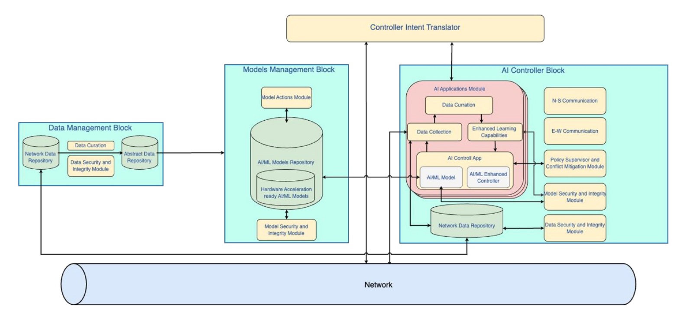

# ModelarDB DMMAI Proof of Concept

Proof of Concept for how to use ModelarDB for data storage in the DMMAI framework.



ModelarDB provides the functionality for ingesting data in multiple AI controllers (AIC), storing it on the AIC,
transferring the stored data to a cloud object store that represents the Data Management Block (DMB), and making the
data available for data curation.

The data can be curated using the ModelarDB Python library and saved in a single file, for example using CSV. The
SLICES Metadata Registry System (MRS) can then be used to store metadata about the curated data and make the datasets
searchable and accessible.


This file provides a guide to deploy ModelarDB and SLICES MRS (MRS) in a docker cluster mode. They comprise the core part of the DMMAI's Data Management Block.

## Prerequisites
Two main repositories are used:
1. __Closed__ repository of SLICES MRS (Please get the access to it over email). 
2. The following repository of ModelarDB cluster available under this [link](https://github.com/CGodiksen/ModelarDB-DMMAI).

## Running the Proof of Concept

1. Change to `./mrs_dmi_upload` directory _(After obtaining access to it)_.
2. Follow `./mrs_dmi_upload/README.md` to start Traefik and MRS. This will start the following services:
   - `traefik-traefik-1` - Traefik container for networking.
   - `slices-mrs-domains-mini_dmi-1` - MRS SLICES component
   - `slices-mrs-domains-pgadmin-1` - MRS SLICES component
   - `slices-mrs-domains-dataset-describer-1` - MRS SLICES component
   - `slices-mrs-domains-mrs_portal-1` - MRS SLICES component
   - `slices-mrs-domains-createbuckets-1` - MRS SLICES component
   - `slices-mrs-domains-idp_config-1` - MRS SLICES component
   - `slices-mrs-domains-mrs_backend-1` - MRS SLICES component
   - `slices-mrs-domains-minio-1` - Used by ModelarDB and MRS SLICES component. 
   - `slices-mrs-domains-idp-1` - MRS SLICES component
   - `slices-mrs-domains-database-1` - MRS SLICES component
3. After you start Traefik and MRS, change to `../ModelarDB-DMMAI` directory.
4. Run the following bash command: 
```bash
docker-compose -p modelardb-cluster -f docker-compose-cluster.yml up
```

This will start the following services:

- `create-bucket` - A one-time job to create the buckets `modelardb` and `datasets` in MinIO.
- `modelardb-edge-1` - ModelarDB edge node representing an AI controller in the DMMAI framework.
- `modelardb-edge-2` - ModelarDB edge node representing another AI controller in the DMMAI framework.
- `modelardb-cloud` - ModelarDB cloud node representing the Data Management Block in the DMMAI framework.
- `modelardb-ingest` - A Rust binary that ingests data into the ModelarDB edge nodes.
- `upload-metadata` - A python container for uploading metadata to Minio instance running in `slices-mrs-domains-minio-1`.

When up and running, the ingested data and metadata (used for SLICES MRS) is transferred to the MinIO object store and can be accessed using the MinIO
web interface at `http://localhost:9001` using `minio_admin` as both username and `ABCDEFGHIJKLMNOPQRSTUVWXYZ1234` as password.

At this point you have the following services running: __Traefik__ (used for networking), __SLICES MRS__ (used as Abstract Data Repository), __ModelarDB Cloud node__ (used as Network Data Repository) and __2 ModelarDB edge nodes__ (used as AICs in this setup). Now we start ingesting data to ModelarDB and then to MRS.


5. To upload data to MRS change to `./ModelarDB-DMMAI/curate_data/`. 
6. Run `docker compose -f docker-compose.yml up`. This will first read the sensor data from `modelardb-cloud` and its metadata from `slices-mrs-domains-minio-1` (see Step 2 for how they are created). Then the sensor data is curated after which it is uploaded to the MRS SLICES along with it downloaded metadata.

## Limitations
At the moment the data itself, its metadata for MRS and the subsequent table/MinIO bucket names are hard coded in the scripts. We will make this customizable once we have more clear idea about the data being used for the demo. Once you have all containers running, you can check them through MinIO UI: `127.0.0.1:9000`

The docker compose file can be started using the following command from the root of this repository:
